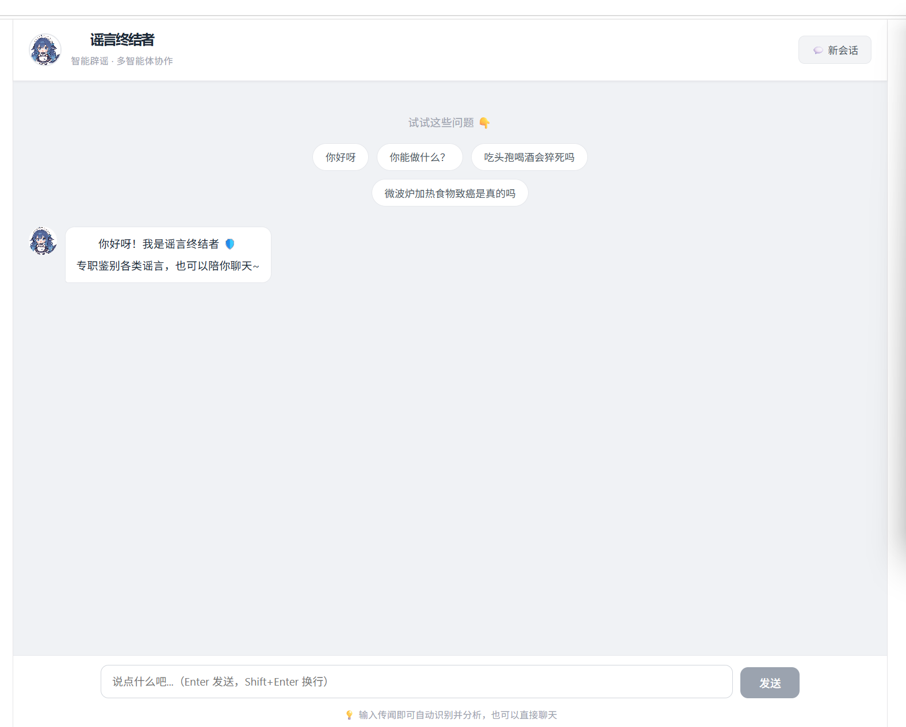

# 谣言终结者 · 多智能体辟谣系统

基于大语言模型（LLM）与检索增强生成（RAG）技术的谣言分析系统。采用**多智能体协作架构**，结合本地辟谣知识库与互联网权威检索，对用户输入的传闻进行多源交叉验证，输出结构化的辟谣分析报告。同时支持日常闲聊对话，由意图识别智能体自动路由。

## 效果预览



## 功能特性

### 🤖 多智能体协作
- **意图识别智能体**：自动判断用户意图（谣言分析 / 闲聊对话 / 不确定），智能路由到对应智能体
- **谣言分析智能体**：专业的谣言核查，多源证据交叉验证
- **闲聊智能体**：日常对话、打招呼、功能引导，性格亲切幽默

### 🔍 检索增强（RAG）
- **本地知识库检索**：基于 FAISS 向量数据库检索本地辟谣资料，支持语义相似度匹配
- **联网事实核查**：通过 Tavily 搜索获取互联网权威信息，与本地证据交叉验证
- **多源冲突分析**：自动对比本地与联网证据，指出冲突点并说明采信逻辑
- **置信度评分**：基于本地相关度、来源数量及证据冲突情况客观计算（0 ~ 100%）

### 🧠 长时记忆
- **会话持久化**：基于 SQLite 存储对话历史，重启服务不丢失
- **语义检索（可选）**：支持 FAISS 向量索引，语义搜索历史对话
- **自动过期清理**：可配置消息保留天数，自动清理过期数据
- **记忆上下文注入**：自动将历史对话作为上下文提供给 LLM

### 📊 生产级日志与监控
- **全链路 Trace ID**：请求级链路追踪，所有日志自动带上 Trace ID
- **分级分类日志**：主日志 + 错误日志 + 访问日志（独立文件）
- **多模式轮转**：按大小 / 按时间 / 双重触发，支持 gzip 压缩
- **Agent 监控**：实时统计 LLM 调用次数、Token 消耗、工具调用、响应耗时
- **日志分析脚本**：一键生成请求汇总报表

### 💬 前端对话界面
- 类 ChatGPT 对话式交互，支持文本消息和谣言分析卡片
- 快捷提问、新会话、本地会话持久化
- 响应式设计，打字动画，流畅体验

## 技术栈

| 模块 | 技术 |
|------|------|
| 后端 | Python + FastAPI |
| AI Agent | LangChain + LangGraph + OpenAI 兼容接口 |
| 向量检索 | FAISS + BGE Embedding（本地）/ DashScope（云端） |
| 联网搜索 | Tavily Search API |
| 长时记忆 | SQLite + 可选 FAISS 语义检索 |
| 日志系统 | 自研生产级日志模块（多轮转 + Trace ID + 结构化） |
| 前端 | Vue 3 + Vite |

## 快速开始

### 环境要求

- Python >= 3.10
- Node.js >= 18
- 可用的 OpenAI 兼容大模型 API
- Tavily API Key（联网搜索）

### 1. 克隆与安装

```bash
git clone <your-repo-url>
cd yaoyan/back

# 方式一：使用 uv（推荐，更快）
uv sync

# 方式二：使用 pip + pyproject.toml
pip install -e .

# 方式三：使用 requirements.txt
pip install -r requirements.txt
```

### 2. 配置环境变量

复制模板文件并填写你的密钥：

```bash
cp .env.example .env
```

编辑 `.env`，填入以下关键信息（完整配置见 `.env.example`）：

```env
# 大模型（OpenAI 兼容格式）
LLM_BASE_URL=https://api.openai.com/v1
LLM_API_KEY=your-llm-api-key

# Tavily 联网搜索
TAVILY_API_KEY=your-tavily-api-key

# Embedding 配置
# 模式：local（本地 BGE）或 dashscope（云端）
EMBEDDING_MODE=local

# 本地 BGE 模型路径（可选，默认自动下载 BAAI/bge-small-zh-v1.5）
BGE_LOCAL_DIR=./models/bge-small-zh-v1.5
BGE_DEVICE=cpu

# DashScope 云端兜底（当本地模型加载失败时自动回退）
DASHSCOPE_BASE_URL=https://dashscope.aliyuncs.com/compatible-mode/v1
DASHSCOPE_API_KEY=your-dashscope-key

# 知识库与索引路径
KKB_PATH=./knowledge_base
INDEX_PATH=./faiss_index

# 长时记忆（可选）
MEMORY_DB_PATH=memory.db
MEMORY_USE_FAISS=0
```

### 3. 准备知识库

在 `back/knowledge_base/` 目录下放入你的辟谣资料（支持 `.md` 文件）。系统启动时会自动构建向量索引。

### 4. 启动后端

```bash
cd back
python lie_server.py
```

启动后日志会显示以下信息：
- API 文档：http://localhost:8000/docs
- 健康检查：http://localhost:8000/health
- 记忆统计：http://localhost:8000/api/memory/stats

### 5. 启动前端

```bash
cd ../frontend
npm install
npm run dev
```

打开浏览器访问 http://localhost:5173 即可使用。

## API 说明

### 统一对话接口（推荐）

#### POST `/api/chat`

统一对话入口：自动识别用户意图，路由到对应智能体。

**请求示例：**
```bash
curl -X POST http://localhost:8000/api/chat \
  -H "Content-Type: application/json" \
  -d '{"message": "吃头孢喝酒会猝死吗", "session_id": "your-session-id"}'
```

**响应（谣言分析）：**
```json
{
  "type": "rumor",
  "content": "",
  "rumor_result": {
    "key_entities": {
      "subject": "头孢",
      "time": "未提及",
      "location": "未提及",
      "event": "吃头孢后喝酒会导致猝死"
    },
    "verdict": "真实",
    "confidence": 0.92,
    "basis": ["..."],
    "conflict_analysis": "...",
    "conclusion": "...",
    "reference": [
      { "source": "本地辟谣知识库", "url": "" },
      { "source": "某医学权威网站", "url": "https://example.com/article" }
    ],
    "memory_used": false,
    "history_count": 0
  },
  "intent": {
    "intent": "rumor",
    "confidence": 0.95,
    "reason": "用户在询问说法的真实性",
    "extracted_rumor": "吃头孢喝酒会死"
  },
  "monitor": {
    "duration_seconds": 5.23,
    "llm_call_count": 3,
    "total_tokens": 1250,
    "retry_count": 0
  },
  "session_id": "your-session-id"
}
```

**响应（闲聊）：**
```json
{
  "type": "text",
  "content": "你好呀！我是谣言终结者，可以帮你鉴别各类谣言~",
  "rumor_result": null,
  "intent": {
    "intent": "chat",
    "confidence": 0.98,
    "reason": "用户在打招呼",
    "extracted_rumor": ""
  },
  "monitor": { ... },
  "session_id": "your-session-id"
}
```

### 谣言分析接口（旧版）

#### POST `/api/analyze`

直接提交传闻进行谣言分析（不走意图识别）。请求参数和 `rumor_result` 结构同上。

### 记忆管理接口

| 方法 | 路径 | 说明 |
|------|------|------|
| GET | `/api/memory/stats` | 获取记忆库统计信息 |
| GET | `/api/memory/history/{session_id}` | 获取某会话的记忆历史 |
| DELETE | `/api/memory/session/{session_id}` | 删除某会话的记忆 |

### 健康检查

#### GET `/health`

```bash
curl http://localhost:8000/health
```

## 项目结构

```
yaoyan/
├── back/                              # 后端服务
│   ├── lie_server.py                  # 入口文件，启动服务
│   ├── api.py                         # FastAPI 路由定义（所有接口）
│   │
│   ├── agent.py                       # 多智能体系统
│   │   ├── intent_agent               #   意图识别智能体
│   │   ├── rumor_agent                #   谣言分析智能体
│   │   └── chat_agent                 #   闲聊智能体
│   │
│   ├── tools.py                       # 工具定义
│   │   ├── web_search                 #   联网搜索（指数退避重试）
│   │   ├── local_kb_search            #   本地知识库检索
│   │   └── calculate_confidence       #   置信度计算
│   │
│   ├── memory.py                      # 长时记忆模块
│   │   ├── MemoryDB                   #   SQLite 存储层
│   │   ├── MemoryVectorStore          #   FAISS 语义检索（可选）
│   │   └── MemoryManager              #   统一管理器
│   │
│   ├── knowledge_base.py              # 本地知识库 FAISS 加载/构建
│   ├── llm.py                         # 大模型 + Embedding 初始化
│   ├── schemas.py                     # Pydantic 数据模型
│   ├── session.py                     # 会话管理辅助函数
│   ├── callbacks.py                   # Agent 监控回调（Token/耗时/工具调用）
│   ├── logger_setup.py                # 生产级日志系统初始化
│   ├── config.py                      # 全局配置（环境变量）
│   │
│   ├── log_report.py                  # 日志分析脚本（请求汇总报表）
│   ├── eval_retrieval.py              # 检索质量评估脚本（HitRate@K）
│   │
│   ├── pyproject.toml                 # Python 依赖配置（uv / pip）
│   ├── requirements.txt               # Python 依赖清单（pip 兼容）
│   ├── .env.example                   # 环境变量模板
│   └── knowledge_base/                # 本地辟谣知识库（Markdown 文件）
│       └── 谣言.md
│
├── frontend/                          # 前端页面
│   ├── src/
│   │   ├── App.vue                    # 主应用（对话界面）
│   │   ├── components/
│   │   │   └── RumorCard.vue          # 谣言分析结果卡片组件
│   │   ├── assets/                    # 静态资源
│   │   ├── main.js                    # 入口文件
│   │   └── style.css                  # 全局样式
│   ├── public/                        # 公共资源
│   ├── index.html
│   ├── package.json
│   └── vite.config.js
│
├── screenshots/                       # 项目截图
│   └── 谣言智能体前端.png
│
├── README.md                          # 项目说明
└── .gitignore
```

> 注：`faiss_index/`（向量索引）、`models/`（本地模型）、`logs/`（日志）、`memory.db`（记忆数据库）会在运行时自动生成，已被 `.gitignore` 排除。

## 辅助脚本

### 日志分析

```bash
cd back
python log_report.py
```

自动解析 `logs/app.log`，生成请求汇总报表，包含：总请求数、平均耗时、平均 Token 消耗、平均 LLM 调用次数等。

### 检索质量评估

```bash
cd back
python eval_retrieval.py
```

自动计算本地知识库检索的 HitRate@1 / HitRate@3 / MRR 等指标，评估向量检索效果。

## 注意事项

1. **索引隔离**：不同 Embedding 模型生成的向量空间互不兼容，系统会自动按实际生效的 Embedding 模式（`local` / `dashscope`）隔离索引目录，避免混用导致检索异常。

2. **模型自动回退**：当 `EMBEDDING_MODE=local` 且本地 BGE 模型加载失败时，系统会自动回退到 DashScope 云端 Embedding，确保服务仍能启动。

3. **来源真实性**：联网搜索返回的引用 URL 直接来自 Tavily 检索结果，严禁捏造或修改 URL。

4. **长时记忆**：默认使用 SQLite 存储对话记忆，数据保存在 `memory.db`。如需语义检索能力，设置 `MEMORY_USE_FAISS=1`。

5. **CORS**：后端默认开启全跨域支持（`allow_origins=["*"]`），生产环境请按需收紧。

6. **日志系统**：日志默认保存在 `logs/` 目录，支持按大小/时间轮转、自动压缩、过期清理。完整配置项见 `.env.example`。

## License

MIT
